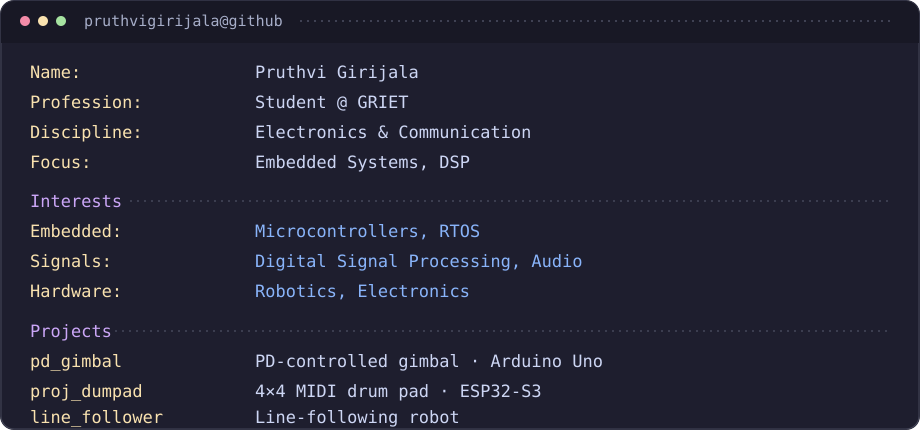

  

## Projects

- **[PD Gimbal](https://github.com/pruthvigirijala/pd_gimbal)** — Arduino Uno, MG995 servo, and ADXL accelerometer with a proportional-derivative (PD) control system. [LinkedIn post](https://lnkd.in/p/d3qwbmRx)
- **[MIDI Drum Pad](https://github.com/pruthvigirijala/proj_dumpad)** — A custom 4×4 button matrix using the ESP32-S3 as a MIDI controller for a DAW. [LinkedIn post](https://lnkd.in/p/d7cNT3ef)
- **[Line Follower](https://github.com/pruthvigirijala/line_follower)** — A line-following robotics project.

## Connect

  
  
  

